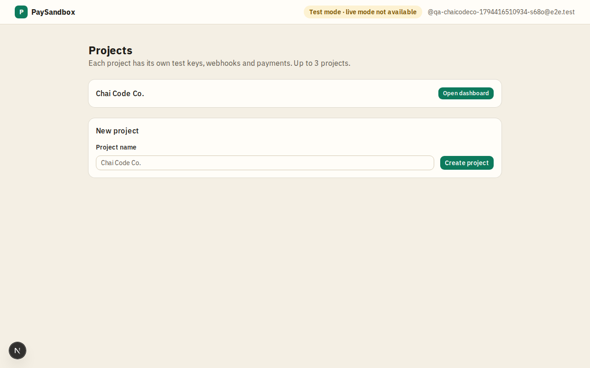

# Overview

## What PaySandbox is
PaySandbox lets a developer build and demo a complete, realistic online payment flow without a real payment provider. It behaves like a card payment gateway in test mode: a merchant's site asks PaySandbox to start a checkout, the customer pays on PaySandbox's own page with a test card, PaySandbox tells the merchant's server what happened through signed webhooks, and the merchant manages everything in a dashboard.

It is also Abdul's portfolio piece, so it shows payments depth: a payment state machine, safe retries, signed webhooks with retries, partial refunds, disputes and safe handling of card-like data.

## Who uses it
| Who | What they do |
|---|---|
| **Admin** (Abdul) | Decides who may sign up (invite-only allowlist of GitHub accounts). |
| **Merchant / developer** | Signs in with GitHub, creates up to 3 projects, connects their site with test keys, watches payments, refunds, disputes and webhooks. |
| **Customer** (the merchant's visitor) | Pays on the hosted checkout page with a test card, then returns to the merchant's site. |
| **Merchant's server** | Starts checkouts and refunds with the secret key, receives webhooks. |

## Key entities
| Entity | Meaning |
|---|---|
| **Project** (merchant account) | One integration: its own keys, one webhook address, its own payments and customers. A user owns up to 3. |
| **API keys** | A publishable key (only opens the checkout) and a secret key (everything else). Both are test keys; there is no live mode. |
| **Checkout session** | One "please pay this" request: amount, up to 20 line items, where to send the customer after paying or cancelling. Open for 24 hours. |
| **Payment** | One attempt to pay a session with a test card. A session can have several attempts (a declined one, then a successful one). |
| **Customer** | Created from the email typed at checkout, one per email per project. |
| **Refund** | Money given back on a successful payment, full or partial. |
| **Dispute** | A simulated chargeback: the customer's bank challenges the payment, the merchant wins or loses it. |
| **Event** | A record that something happened (payment succeeded, refund created…). Each event is sent to the merchant's webhook address. |
| **Webhook endpoint** | The merchant's server address that receives events, with its signing secret. |

## Core rules
- The system shall never accept, store or log a real card number. Only PaySandbox's own test cards work (see [Test cards](../pages/test-cards.md)).
- The system shall show the TEST MODE banner on every checkout screen, and no merchant setting can hide it.
- All amounts are in **Pakistani rupees (PKR)**, from PKR 1 to PKR 1,000,000 per checkout.
- The system shall never show one merchant another merchant's data; a wrong project or payment address shows the 404 page.
- Everything runs on free tiers; daily caps per project keep one merchant from using them up (see [Safety and limits](safety-and-limits.md)).

## Not in v1 (on purpose)
Live mode or real money (ever), currencies other than PKR, a card form inside the merchant's own page, open public sign-up, subscriptions, saved cards, payouts, invoices, team members, more than one webhook address per project, email notifications, merchant logos on the checkout. Several of these are planned: see [Future scope](../future-scope/README.md).

## Screenshots

