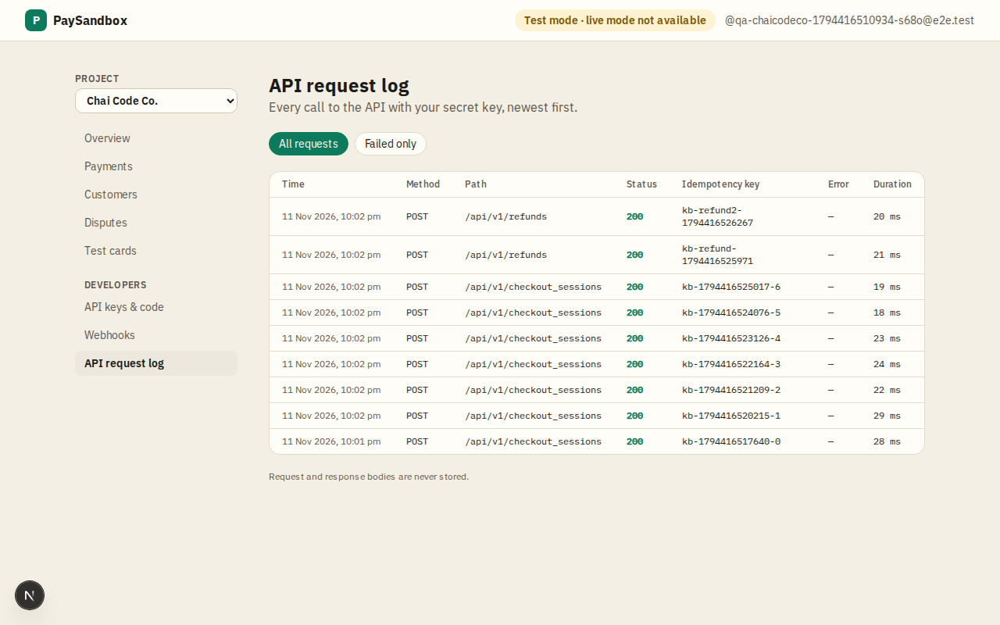

# API request log

**Area:** dashboard · **Who uses it:** developer · **Reached from:** sidebar "API request log"

## What this page is for
Every call the merchant's server made to the PaySandbox API, to debug an integration.

## What it shows
- Method, path, response status, error code (if any), idempotency key, duration and time.
- An empty state: requests show up as soon as the server makes its first call.

## What the user can do
- Page through older requests.

## Rules
- The system shall never record request or response bodies.
- The system shall not record requests refused for the daily cap.

## Open questions
- None.

## Screenshots

