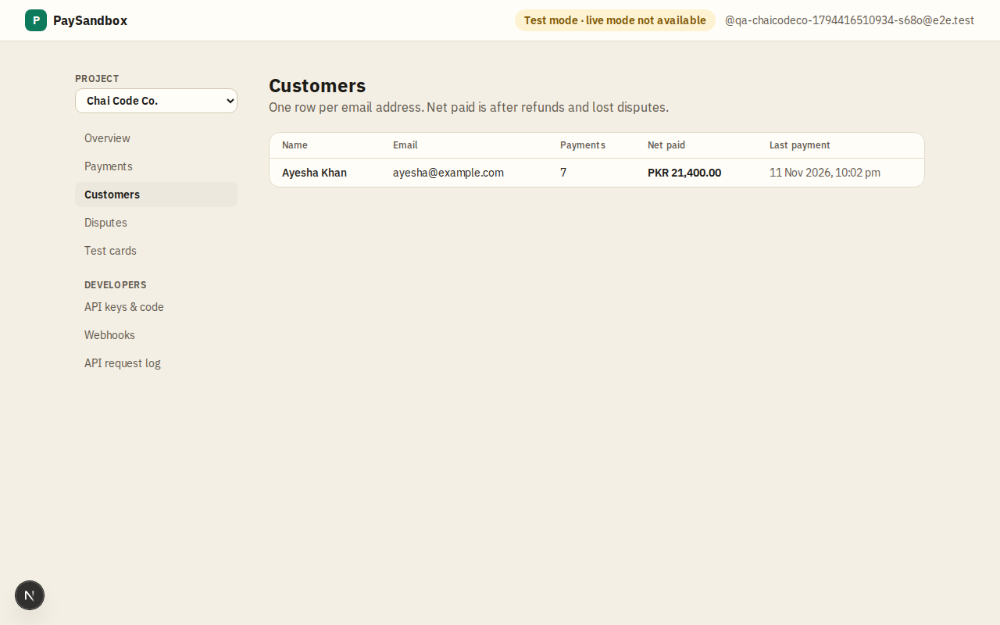

# Customers

**Area:** dashboard · **Who uses it:** merchant · **Reached from:** sidebar "Customers"

## What this page is for
The people who have paid this project, created automatically from the email typed at checkout.

## What it shows
- Each customer's name, email, number of payments, net paid (paid minus refunded) and last payment time.
- An empty state: a customer is added the first time someone pays with their email.

## What the user can do
- Open a customer's payments (the payments list filtered to that email).

## Rules
- The system shall keep one customer per email per project.
- The system shall never show customers of another project.

## Open questions
- None.

## Screenshots

