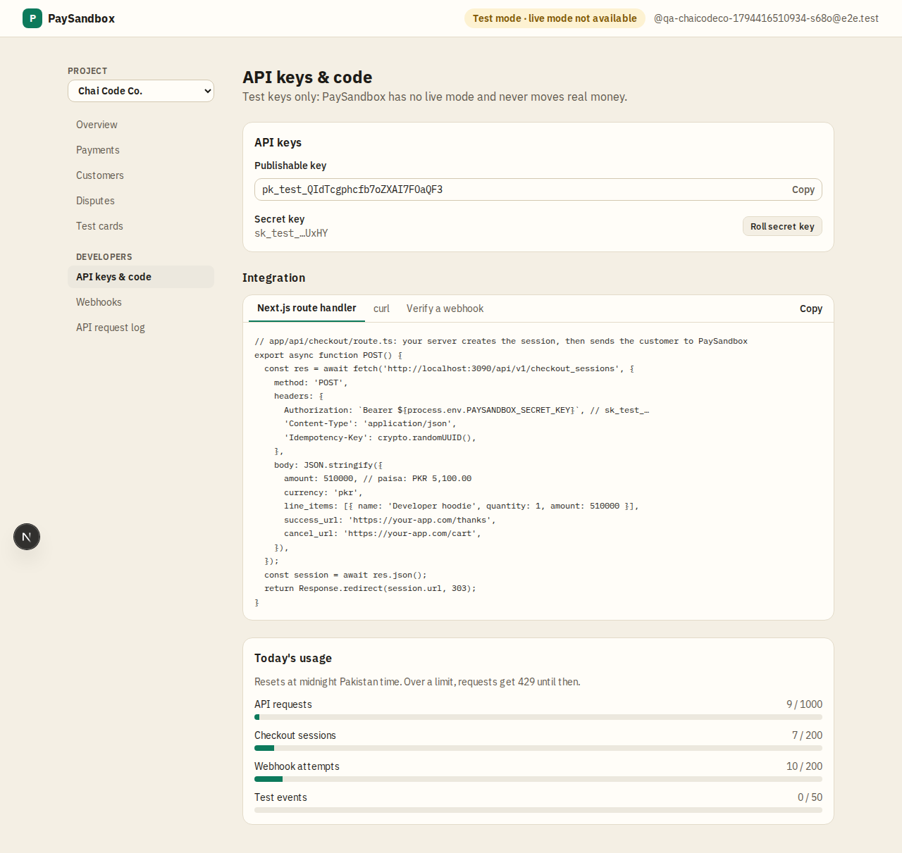

# API keys & code

**Area:** dashboard · **Who uses it:** developer · **Reached from:** sidebar "API keys & code"

## What this page is for
Everything a developer needs to connect a site: keys, ready-to-copy code and today's usage. Test keys only: PaySandbox has no live mode and never moves real money.

## What it shows
- **Publishable key** in full, and the **secret key** as its last 4 characters.
- Code snippets: create a checkout session (curl and a Next.js route handler) and verify a webhook.
- **Today's usage** against the daily caps: API requests, checkout sessions, webhook attempts, test events. Resets at midnight Pakistan time.

## What the user can do
- Copy the publishable key and the snippets.
- **Roll secret key:** a new secret key is shown once; the old one keeps working for 24 hours.

## Rules
- The system shall show the secret key only at creation and at roll.
- The system shall keep a rolled key working for 24 hours.
- Over a daily cap, the system shall refuse requests with "daily limit reached" until midnight Pakistan time.

## Open questions
- None.

## Screenshots

