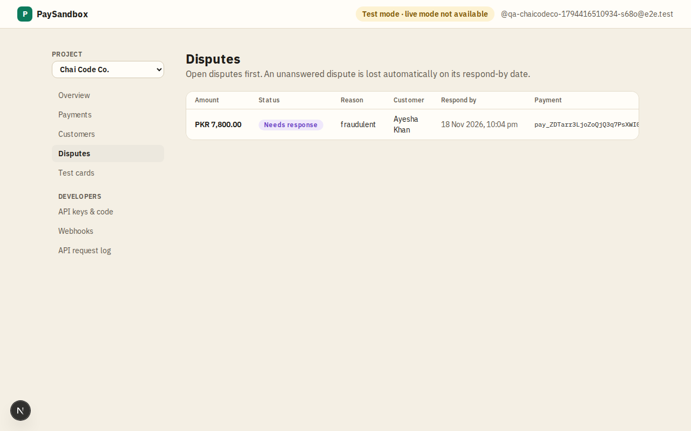

# Disputes

**Area:** dashboard · **Who uses it:** merchant · **Reached from:** sidebar "Disputes"

## What this page is for
All simulated chargebacks, open ones first. An unanswered dispute is lost automatically on its respond-by date.

## What it shows
- Each dispute's amount, reason (for example fraudulent, or product not received), customer, status (needs response, won, lost) and respond-by date.
- An empty state explaining how to get one: pay with card 4000 0000 0000 0259, or use More → "Simulate dispute" on a payment.

## What the user can do
- Open the payment to answer the dispute: win it or accept and lose it. A toast confirms that a `dispute.closed` webhook is on its way.

## Rules
- The system shall open a dispute for the payment's amount left, with a respond-by date 7 days later.
- The system shall mark an unanswered dispute as lost on its respond-by date.
- The system shall return a won payment to the state it had before the dispute.

## Open questions
- None.

## Screenshots

