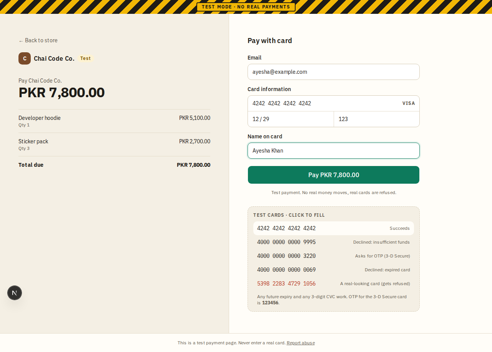
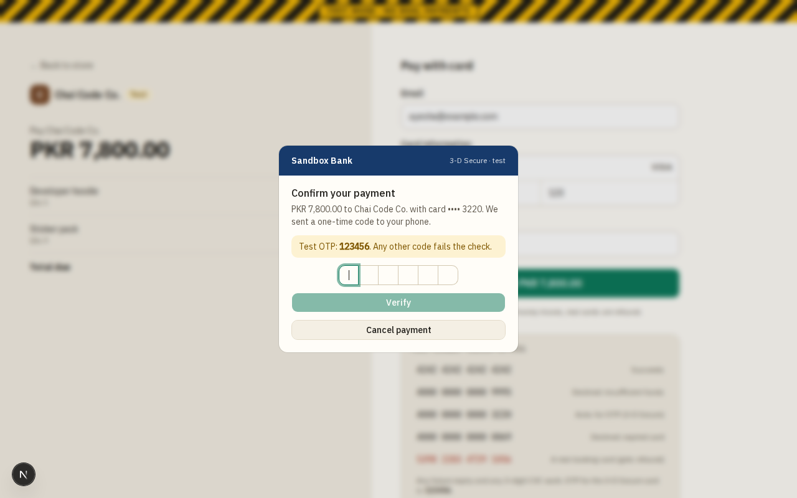

# Hosted checkout

**Area:** checkout · **Who uses it:** the merchant's customer · **Reached from:** the merchant's site redirects here

## What this page is for
PaySandbox's own payment page. The customer pays a checkout session with a test card, then goes back to the merchant's site.

## What it shows
- The TEST MODE banner, always.
- The merchant's name and the order summary (line items and total in PKR).
- A card form (email, name, card number, expiry, CVC) and a picker with the main test cards.
- After paying: a success screen with a button back to the merchant, or a decline screen with the reason and "Try another card".
- For card 3220: the simulated "Sandbox Bank" OTP screen.
- An "already paid" page for a paid session and an "expired" page for an expired one, each linking back to the merchant.
- "Checkout not found" for a wrong address.

## What the user can do
- Pick a test card or type one; pay.
- Enter the OTP (123456) or cancel it.
- Try another card after a decline (the declined attempt stays in the history).
- Return to the merchant's site.

## Rules
- The system shall accept only test card numbers (see [Test cards](test-cards.md)).
- The system shall keep the card field disabled until the page is ready, so nothing typed early is lost.
- The system shall fail the payment after 3 wrong OTP codes or a cancel.
- The system shall send the customer back to the merchant's success address with the payment ID, or to the cancel address.
- The system shall never let another site frame this page.

## Open questions
- None.

## Screenshots

