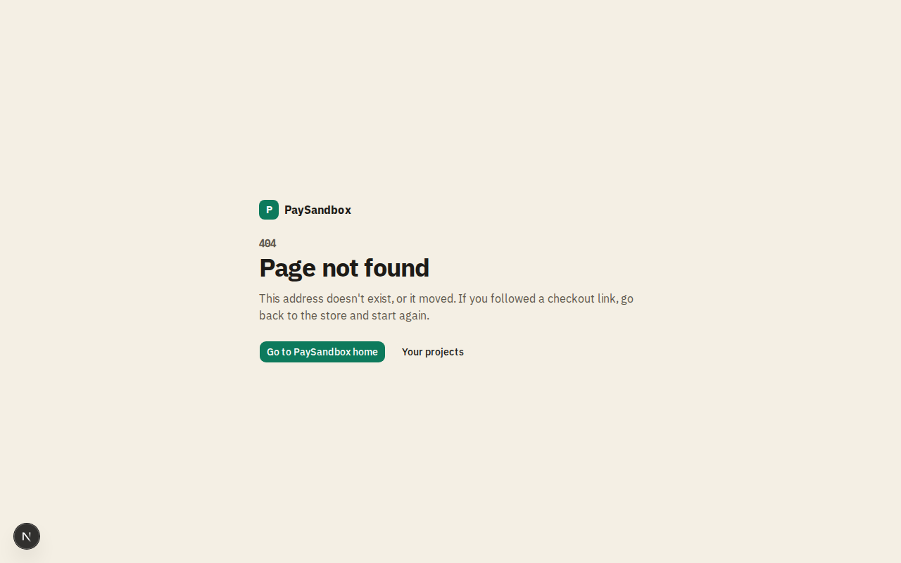

# Page not found

**Area:** account · **Who uses it:** everyone · **Reached from:** any wrong address, or another project's data

## What this page is for
A branded 404 page instead of a blank error.

## What it shows
- "Page not found" with a short explanation and links back to the home page or the dashboard.

## What the user can do
- Go home or to their projects.

## Rules
- The system shall show this page, not an error, for addresses that don't exist and for another merchant's project or payment.

## Open questions
- None.

## Screenshots

