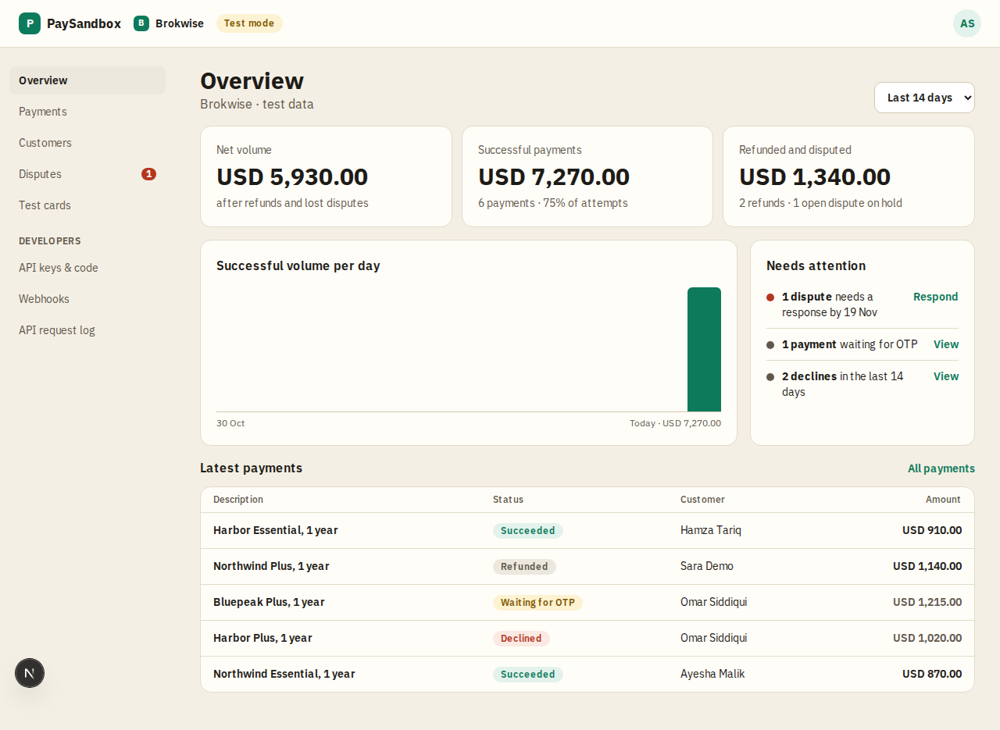

# Overview

**Area:** dashboard · **Who uses it:** merchant · **Reached from:** sidebar "Overview", or opening a project

## What this page is for
A one-glance summary of the project's test payments.

## What it shows
- Totals: **Net volume** (paid minus refunded), **Succeeded**, **Refunded**, **Failed**, **Needs OTP** and **Disputed**.
- **Recent payments** and **Recent webhooks** lists.
- For a new project, an empty state: "Create a checkout session with your secret key and pay it with a test card."

## What the user can do
- Follow the empty-state hint to the developers page, or open recent activity.

## Rules
- The system shall count only this project's payments.
- The system shall show amounts in the project's currency.

## Open questions
- None.

## Screenshots

