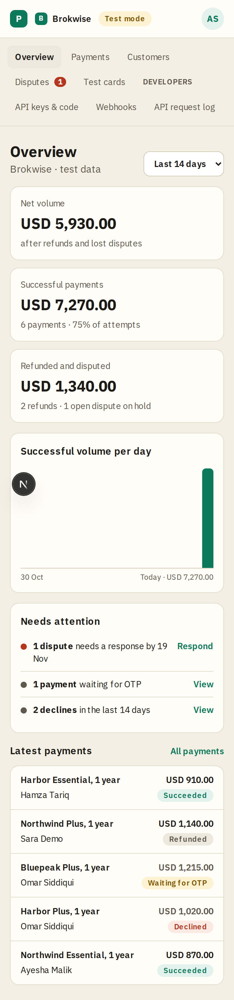

# Overview

**Area:** dashboard · **Who uses it:** merchant · **Reached from:** sidebar "Overview", or opening a project

## What this page is for
A one-glance summary of the project's test payments over a date range: how much money came in, and what needs looking at.

## What it shows
- A **date range** picker: last 7, 14 (the default) or 30 days. The range is part of the address (`?range=7d`), so a link keeps it.
- Three money tiles for payments made in the range:
  - **Net volume**, after refunds and lost disputes.
  - **Successful payments**: the amount captured, how many, and the success rate ("6 payments · 75% of attempts"). Attempts are successful plus declined payments; payments still waiting for an OTP are not counted yet.
  - **Refunded and disputed**: money that left (refunds plus lost disputes), with the counts ("2 refunds · 1 dispute lost · 1 open dispute on hold"). Open disputes are counted but their money is on hold, not taken off.
- **Successful volume per day**: one bar per day of the range, today's bar darker. Screen readers hear the total and the best day.
- **Needs attention**: counts only, each with a link to the list behind it.
  - Disputes waiting for a response, with the earliest respond-by date. These show whatever the range, because they have a deadline.
  - Failing webhook deliveries.
  - Payments waiting for OTP.
  - Declines in the range.
- **Latest payments**: the 5 newest, with description (the first line item's name), status, customer and amount.
- For a new project, an empty state: "Create a checkout session with your secret key and pay it with a test card."

## What the user can do
- Change the range.
- Open a tile, an attention item or a latest payment.
- Follow the empty-state hint to the developers page.

## Rules
- The system shall count only this project's payments.
- The system shall count money by the day the payment was made. A later refund or dispute counts against its payment, so the tiles always add up: Net volume = Successful payments − Refunded and disputed.
- The system shall make the daily bars add up to the Successful payments amount.
- The system shall use Pakistan (Karachi) calendar days for the range and the bars.
- The system shall show amounts in the project's currency.

## Open questions
- None.

## Screenshots

