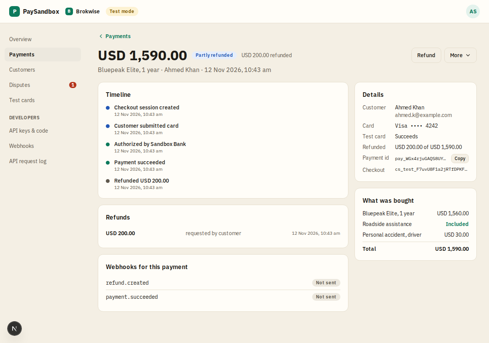
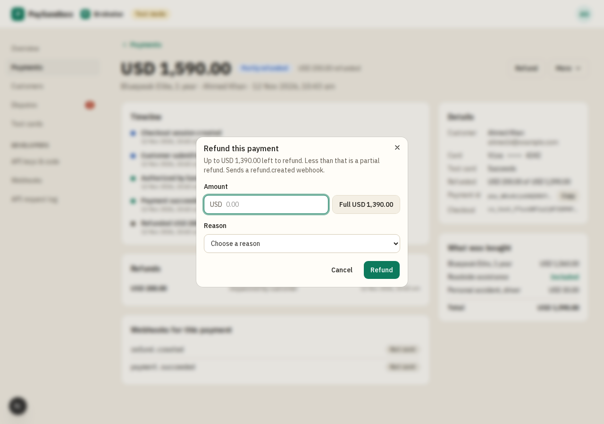

# Payment detail

**Area:** dashboard · **Who uses it:** merchant · **Reached from:** Payments → a payment

## What this page is for
Everything about one payment: what happened, when, and what the merchant can do next. It is meant to be read first and acted on second.

## What it shows
- **Header:**
  - the amount and status, plus how much was refunded when part of it was
  - the description, customer and date
  - two actions: **Refund** (a secondary button) and **More**
- **Timeline** (wide, on the left): every step with its time (created, OTP asked, succeeded or failed, refunded, dispute opened or closed).
- **Refunds:** each refund with amount, reason and time.
- **Webhooks for this payment:** every event sent for it and its delivery status.
- **Details** (on the right):
  - customer
  - card brand and last 4
  - which test card was used
  - decline reason, if any
  - refunded so far
  - the payment ID with a **Copy** button
  - the checkout session ID
- **What was bought:** the line items, "Included" for a line that costs nothing, and the total.
- An open dispute panel when the payment is disputed.

## What the user can do
- **Refund:** opens a dialog.
  - The amount starts **empty**, so a stray click refunds nothing. "Full USD X" fills in what is left; less than that is a partial refund.
  - The merchant picks a reason, then Refund or Cancel.
  - A toast confirms that a `refund.created` webhook is on its way, and the dialog closes.
- **More → Simulate dispute:** asks for confirmation first, then opens a dispute for the amount left, as if the customer's bank challenged it.
- **Answer a dispute:** "Submit evidence and win" (the payment goes back to its previous state) or "Accept and lose", which asks for confirmation first.
- Copy the payment ID.

## Rules
- The system shall offer refunds only on succeeded or partially refunded payments, and never more than the amount left.
- The system shall block refunds while a dispute is open.
- The system shall start the refund amount empty each time the dialog opens.
- The system shall show a 404 page for a payment that belongs to another project.

## Open questions
- None.

## Screenshots

