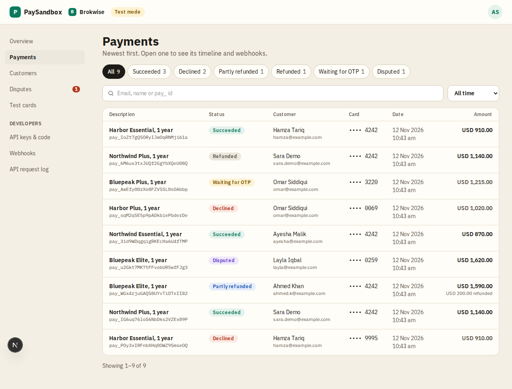
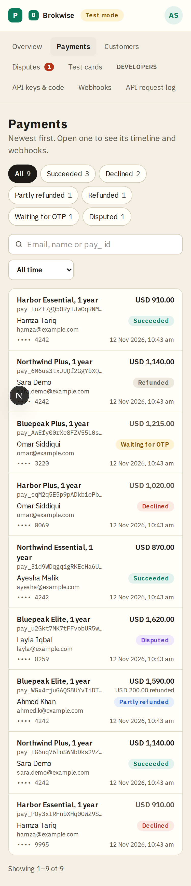

# Payments

**Area:** dashboard · **Who uses it:** merchant · **Reached from:** sidebar "Payments", the overview

## What this page is for
Every test payment, newest first. Open one to see its timeline and webhooks.

## What it shows
- A table with these columns:
  - **Description**: the first line item's name, with the payment ID in small type underneath.
  - **Status**.
  - **Customer**: name and email.
  - **Card**: last 4 digits.
  - **Date**.
  - **Amount**: right-aligned, with "USD 200.00 refunded" underneath when part of it was refunded.
- On a phone each payment is a stacked card, with the description and amount on top. The page never scrolls sideways.
- Status filters with counts: All, Succeeded, Declined, Partly refunded, Refunded, Waiting for OTP, Disputed. "Dispute lost" appears once there is one.
- A **search** box and a **date range**: all time, or the last 7, 14 or 30 days.
- "Showing 26–50 of 312", with Previous and Next.

## What the user can do
- Filter by status, search, and pick a date range. All of these live in the address, so they can be shared and they survive a reload. The search looks at:
  - part of the customer's email or name
  - a whole `pay_` ID
- Filter to one customer, from the customers page or a payment's customer link.
- Page through the results.
- Open a payment's detail.

## Rules
- The system shall list only this project's payments, newest first.
- The system shall keep paging stable while new payments arrive, and the counts on the filters shall match what each filter shows.
- The system shall treat the search as plain text, so `%` or `_` match those characters only.
- The system shall show "No payments match these filters" when nothing matches.

## Open questions
- Merchant references (for example a Brokwise quote number) are not stored on a checkout yet, so they cannot be shown or searched.

## Screenshots

