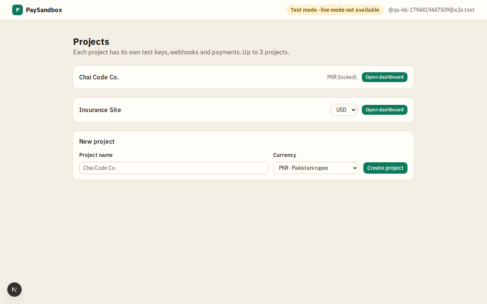

# Projects

**Area:** account · **Who uses it:** merchant · **Reached from:** after sign-in, the account menu's "Your projects", or the PaySandbox logo

## What this page is for
Lists the user's projects (merchant accounts) and creates new ones. Each project is one integration with its own keys, webhook address and data.

## What it shows
- Every project the user owns, by name, each opening that project's overview.
- A "New project" form with the project name and its **currency** (PKR by default; USD, AED, SAR, GBP, EUR).
- Each project's currency: a picker while the project has no checkouts, then the code marked "(locked)".

## What the user can do
- Create a project. Right after creating it, the secret key is shown **once** with an "I've copied it" confirmation; after that only its last 4 characters are visible.
- Change a project's currency until its first checkout (a toast confirms it).
- Open a project.

## Rules
- The system shall allow at most 3 projects per user.
- The system shall accept project names of 2–40 characters and refuse names that copy real Pakistani bank or wallet names.
- The system shall create a publishable key and a secret key for every new project and show the secret key only once.
- The system shall lock a project's currency after its first checkout, so its payments and totals never mix currencies.

## Open questions
- None.

## Screenshots

