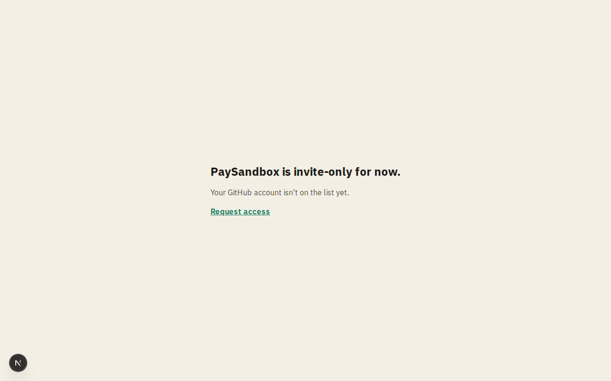

# Home, sign-in and invite-only

**Area:** account · **Who uses it:** everyone · **Reached from:** the home page

## What this page is for
Tells a visitor (often from a portfolio link) what PaySandbox is and sends them to a real journey that pays through it. Lets an invited developer sign in with GitHub, and tells anyone not yet invited that PaySandbox is invite-only.

## What it shows
- The home page: the headline "A payment gateway for demos and MVPs", a test-mode note, three short facts (every outcome via test cards; signed webhooks retried after 1 min, 5 min, 30 min, 2 h and 6 h; refunds and disputes), a "See it in a real journey" button to the car insurance demo site (https://brokwise.vercel.app) and a secondary "Sign in (invite-only)" button.
- For a GitHub account that is not on the allowlist: the "PaySandbox is invite-only for now" page explaining the account isn't on the list yet, with a link to request access by email.

## What the user can do
- Open the car insurance demo and pay a policy through PaySandbox.
- Sign in with GitHub. An invited user lands on their projects; a first-time invited user gets an account created automatically.
- An uninvited user can request access from the invite-only page.

## Rules
- The system shall create an account only for GitHub usernames on the admin's allowlist; the admin is always allowed.
- The system shall not create any account or data for an uninvited visitor.
- The system shall send a signed-in user who opens `/dashboard` to their projects.

## Open questions
- None.

## Screenshots

