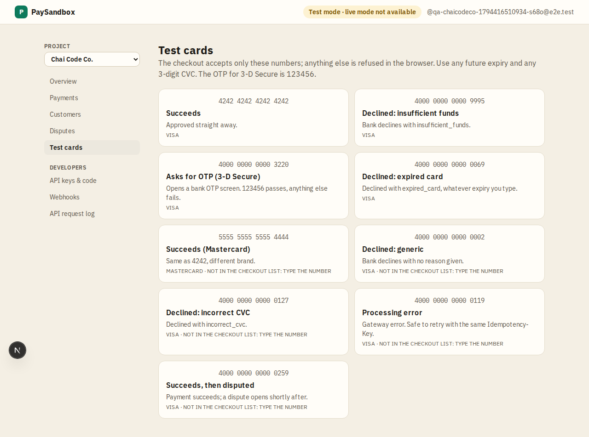

# Test cards

**Area:** dashboard · **Who uses it:** merchant, and customers on the checkout · **Reached from:** sidebar "Test cards"; the card picker on the checkout

## What this page is for
The full catalogue of test card numbers and the outcome each one produces. These are the only card numbers PaySandbox accepts.

## What it shows
Any future expiry date and any 3-digit CVC work.

| Card number | Outcome |
|---|---|
| 4242 4242 4242 4242 | Succeeds |
| 5555 5555 5555 4444 | Succeeds (Mastercard) |
| 4000 0000 0000 3220 | Asks for OTP; 123456 passes, anything else fails |
| 4000 0000 0000 9995 | Declined: insufficient funds |
| 4000 0000 0000 0069 | Declined: expired card |
| 4000 0000 0000 0002 | Declined: generic |
| 4000 0000 0000 0127 | Declined: incorrect CVC |
| 4000 0000 0000 0119 | Processing error (safe to retry) |
| 4000 0000 0000 0259 | Succeeds, then a dispute opens shortly after |

## What the user can do
- Copy a card number. On the checkout, the first four cards are offered in a picker that fills the form.

## Rules
- The system shall accept only these numbers; every other number is refused in the browser and on the server.

## Open questions
- None.

## Screenshots

