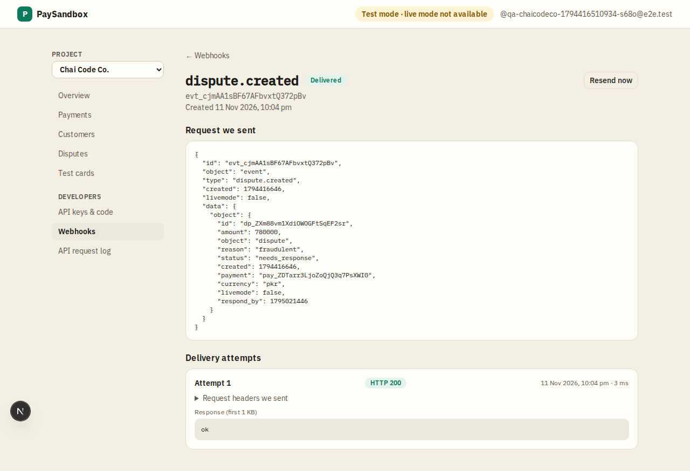

# Webhook event

**Area:** dashboard · **Who uses it:** developer · **Reached from:** Webhooks → an event; Payment detail → "Webhooks for this payment"

## What this page is for
Shows exactly what PaySandbox sent for one event and what the merchant's server answered, so a developer can debug their receiver.

## What it shows
- The event type and ID, and the object it is about.
- The request sent: headers (webhook ID, timestamp, signature) and body.
- Every delivery attempt: time, response status (or timeout), how long it took, and the start of the response.
- The next scheduled retry, if any.

## What the user can do
- **Resend now:** sends the same event again with the same webhook ID, so a correct receiver treats it as a duplicate.

## Rules
- The system shall keep the same webhook ID on every retry and resend.
- The system shall not start a resend while another attempt for the event is already on its way or scheduled.
- The system shall try up to 6 times (now, then 1 min, 5 min, 30 min, 2 h, 6 h) before marking a delivery failed.

## Open questions
- None.

## Screenshots

