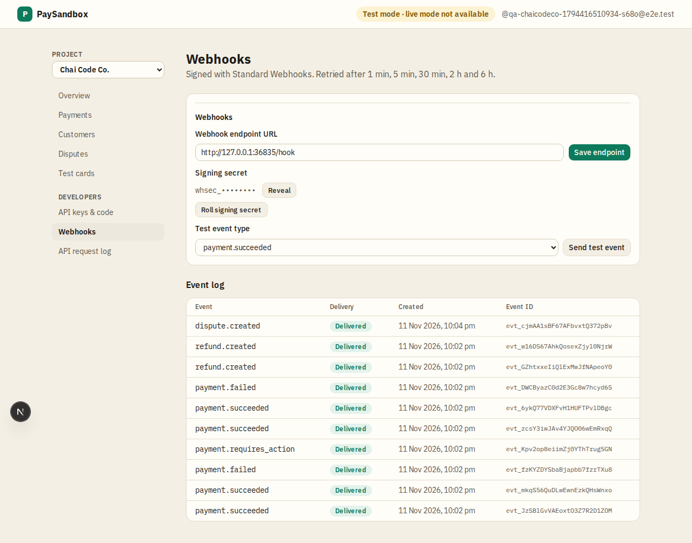

# Webhooks

**Area:** dashboard · **Who uses it:** developer · **Reached from:** sidebar "Webhooks"

## What this page is for
Set the address that receives events, manage its signing secret, and see every event and its delivery. Signed with Standard Webhooks; retried after 1 min, 5 min, 30 min, 2 h and 6 h.

## What it shows
- The **webhook endpoint URL** and whether it is enabled.
- The **signing secret** (revealable and copyable).
- A banner when the endpoint was **disabled after 20 failed events in a row**, with a re-enable button.
- **Send test event** with a choice of event type.
- The **event log**: each event's type, time and delivery status (delivered, retrying, failed, not sent).

## What the user can do
- Save the endpoint URL ("Endpoint saved").
- Reveal or copy the signing secret; **roll** it (the old secret keeps working for 24 hours).
- Re-enable a disabled endpoint.
- Send a test event; it arrives in a few seconds.
- Open an event's detail.

## Rules
- The system shall accept only https addresses that reach the public internet.
- The system shall sign every webhook with both old and new secrets for 24 hours after a roll.
- The system shall disable an endpoint after 20 failed events in a row and show the banner.
- The system shall refuse test events once 50 have been sent today, or when no enabled endpoint is saved.
- The system shall record "not sent" for events that happened while there was no enabled endpoint.

## Open questions
- None.

## Screenshots

